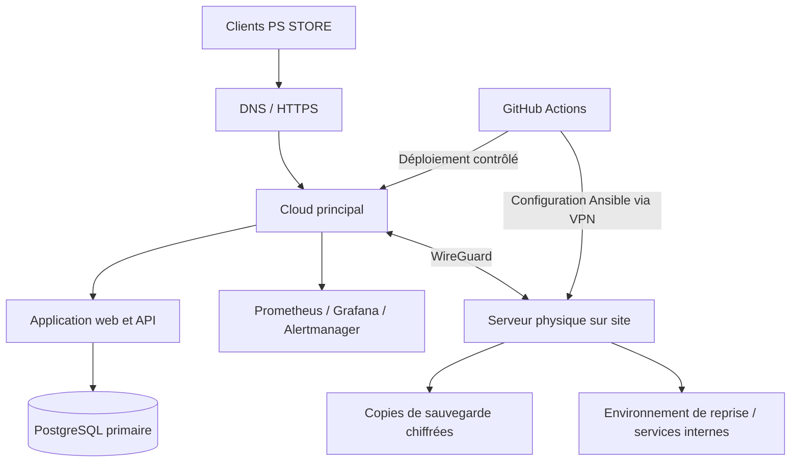

# PS STORE — Cahier des charges de l'administration système hybride

**Version :** 1.0 — 5 novembre 2026  
**Statut :** proposition d'architecture à valider avant achat et mise en production  
**Dépôt :** [Bibichezugu/PS_STORE_PLATEFORME](https://github.com/Bibichezugu/PS_STORE_PLATEFORME)

## 1. Objectif

Mettre en place une infrastructure hybride pour exploiter PS STORE avec un environnement Cloud principal et un serveur physique secondaire dans les locaux de l'entreprise. L'administrateur système dispose d'un centre de contrôle unique pour surveiller, sécuriser, maintenir et dépanner les services.

Ce document décrit une cible technique. **Aucun serveur, abonnement, domaine ou matériel n'est acheté ou déployé par la présente décision.**

## 2. Décisions de conception retenues

| Sujet | Décision de référence | Réserve |
|---|---|---|
| Hébergement principal | Hetzner Cloud | Confirmer région, latence depuis Lubumbashi, coûts, conditions contractuelles et exigences de données avant souscription. |
| Site secondaire | Serveur Dell PowerEdge sur site | Achat à budgéter après validation de la charge, du support local et de l'alimentation électrique. |
| Administration | À distance et depuis les locaux | Accès distant uniquement par VPN et authentification forte. |
| Système | Ubuntu Server LTS | Choisir une version LTS supportée au moment de l'installation. |
| Conteneurs | Docker Compose au démarrage | Éviter Kubernetes tant que le nombre de services et les compétences ne le justifient pas. |
| Réseau privé | WireGuard | Aucun port d'administration exposé directement à Internet. |
| Supervision | Prometheus + Grafana + Alertmanager | Alertes par e-mail et canal de notification à sélectionner. |
| Journaux | Loki | Centralisation avec rétention définie et accès restreint. |
| Automatisation | Ansible + scripts versionnés | Exécution contrôlée, revue des changements et journalisation. |
| CI/CD | GitHub Actions | Tests avant déploiement, secrets dans GitHub Actions Secrets, environnement de production protégé. |
| Sauvegardes | Restic, chiffré, copie hors site | Tester les restaurations ; une sauvegarde non testée n'est pas considérée comme fiable. |

## 3. Architecture cible

### 3.1 Vue logique

### 3.2 Règles d'architecture

- Le Cloud héberge la production et la base de données primaire au départ.
- Le serveur physique est un site secondaire de sauvegarde, de supervision locale et de reprise après sinistre.
- La réplication de base de données, si elle est ajoutée, doit être configurée en lecture seule côté secondaire et accompagnée d'une procédure de promotion contrôlée.
- Ne jamais activer deux bases primaires indépendantes pour les commandes et le stock : cela créerait un risque de divergence et de double vente.
- La bascule automatique n'est autorisée qu'après tests de cohérence, prévention du split-brain, fencing de l'ancien primaire et validation des procédures de retour arrière.
- Les sauvegardes doivent être indépendantes des identifiants d'administration de la production et protégées contre la suppression accidentelle ou malveillante.

## 4. Dimensionnement initial à confirmer

### 4.1 Cloud

Démarrer avec une instance Linux de taille modeste, dimensionnée après mesure de l'application, avec possibilité d'augmenter CPU/RAM/disque. Séparer si nécessaire la base de données de l'application lorsque le trafic et les exigences de disponibilité le justifient.

Prévoir :
- adresse IP et DNS ;
- pare-feu Cloud avec liste minimale de ports ;
- stockage persistant et sauvegardes ;
- métriques de ressources et alertes ;
- snapshots avant les changements majeurs, sans les confondre avec les sauvegardes.

### 4.2 Serveur physique

Point de départ à chiffrer avec un revendeur Dell agréé :
- gamme tour PowerEdge (par exemple T360/T160 selon charge et budget) ;
- processeur serveur compatible avec la charge retenue ;
- mémoire ECC, cible initiale 32 à 64 Go selon virtualisation et services ;
- deux SSD en miroir pour le système et les services critiques ;
- stockage séparé pour les sauvegardes, avec capacité calculée à partir du volume réel et de la rétention ;
- alimentation protégée par onduleur (UPS) et arrêt contrôlé ;
- deux interfaces réseau si l'architecture locale le demande ;
- garantie et support adaptés, pièces de rechange disponibles localement.

Le modèle définitif, les disques, la mémoire, la redondance d'alimentation et le budget doivent être confirmés par devis. Le serveur physique ne remplace pas une sauvegarde hors site.

## 5. Sécurité obligatoire

1. Comptes nominatifs, pas de compte administrateur partagé.
2. MFA pour GitHub, Cloud, VPN et consoles d'administration.
3. SSH par clé ; désactiver la connexion root directe et l'authentification SSH par mot de passe.
4. Pare-feu par défaut en refus ; ouvrir uniquement HTTPS et les flux explicitement nécessaires.
5. Administration distante uniquement via WireGuard ou bastion durci.
6. Secrets hors du dépôt Git ; rotation et révocation documentées.
7. Correctifs de sécurité appliqués selon une fenêtre de maintenance.
8. Chiffrement TLS en transit et chiffrement des sauvegardes au repos.
9. Journal d'audit des connexions, changements de configuration, déploiements et actions sensibles.
10. Comptes de service à privilèges minimaux.
11. Protection contre les tentatives de connexion abusives et surveillance des alertes de sécurité.
12. Test périodique de restauration et exercice de réponse à incident.

Ne jamais committer de mots de passe, clés privées, jetons API, fichiers .env réels ou sauvegardes contenant des données clients.

## 6. Supervision et seuils de départ

Les seuils ci-dessous sont des valeurs initiales à ajuster après observation de la charge réelle.

| Signal | Avertissement | Critique | Action |
|---|---:|---:|---|
| CPU | > 80 % pendant 10 min | > 95 % pendant 5 min | Diagnostiquer processus et charge ; alerter. |
| RAM | > 80 % | > 95 % ou OOM | Identifier fuite/charge ; ne pas redémarrer à l'aveugle. |
| Disque | > 75 % | > 90 % | Identifier les fichiers ; augmenter capacité ou appliquer rétention approuvée. |
| Disponibilité HTTP | Échec de sonde | 3 échecs consécutifs | Alerte et diagnostic réseau/application. |
| Certificat TLS | Expire dans 21 jours | Expire dans 7 jours | Renouvellement automatisé et vérification. |
| Sauvegarde | Retard supérieur à 1 cycle | Échec ou absence > 24 h | Alerte immédiate et relance contrôlée. |
| PostgreSQL | Connexions/latence en hausse | Base inaccessible | Alerte, diagnostic et procédure DB. |
| VPN | Perte de tunnel | Perte prolongée du site | Alerte et vérification des deux extrémités. |

Tableaux Grafana recommandés : santé globale, Cloud, serveur local, PostgreSQL, application/API, sauvegardes, réseau/VPN, sécurité et incidents.

## 7. Automatisation et CI/CD

### Pipeline de livraison

1. Développeur ouvre une Pull Request.
2. GitHub Actions exécute lint, tests unitaires, tests d'intégration et vérifications de sécurité.
3. Une image versionnée est construite et publiée.
4. Déploiement automatique en environnement de test.
5. Validation fonctionnelle.
6. Approbation humaine obligatoire pour la production.
7. Déploiement progressif ou avec fenêtre de maintenance.
8. Vérification de santé après déploiement.
9. Retour à la version précédente si les contrôles échouent.

### Automatisations d'exploitation

- collecte des métriques et journaux ;
- contrôle périodique des sauvegardes ;
- vérification de l'expiration des certificats ;
- rapport quotidien de santé ;
- création d'un incident lors d'une alerte critique ;
- exécution Ansible des configurations approuvées ;
- rotation des journaux selon une politique de rétention ;
- mises à jour planifiées après test, jamais sans contrôle sur la production.

## 8. Gestion des incidents

### Niveaux

| Niveau | Exemple | Délai de prise en charge cible |
|---|---|---|
| P1 — Critique | Boutique indisponible, suspicion de compromission, perte de données | Immédiat / astreinte |
| P2 — Élevé | Paiement ou commandes dégradés, base instable | Dans l'heure ouvrée |
| P3 — Moyen | Fonction secondaire indisponible, lenteur limitée | Dans la journée ouvrée |
| P4 — Faible | Demande mineure ou alerte informative | Planification |

Ces délais sont des objectifs opérationnels à confirmer selon les horaires et les moyens humains disponibles ; ils ne constituent pas un SLA contractuel.

### Cycle de traitement

Détection → qualification → notification → confinement → diagnostic → correction/rétablissement → validation métier → rapport post-incident.

Chaque fiche d'incident conserve : identifiant, date, service touché, sévérité, impact, responsable, chronologie, cause racine, actions, durée, données potentiellement concernées et mesures préventives.

### Runbooks à rédiger et tester

- indisponibilité de l'application ;
- panne de l'instance Cloud ;
- perte du VPN ;
- panne du serveur physique ;
- espace disque saturé ;
- échec de sauvegarde ;
- corruption ou indisponibilité PostgreSQL ;
- suspicion de fuite de secrets ou compromission ;
- déploiement défectueux ;
- restauration complète et retour au fonctionnement normal.

## 9. Sauvegarde, reprise et objectifs

Objectifs initiaux à valider avec le Product Owner et la direction :
- **RPO cible :** 24 heures maximum au MVP, puis réduire selon le besoin métier et le coût.
- **RTO cible :** 8 heures maximum au MVP, à confirmer après exercice de reprise.
- Sauvegarde quotidienne chiffrée de la base et des fichiers ; sauvegarde plus fréquente si le volume de commandes le justifie.
- Copie hors site indépendante ; conserver plusieurs points de restauration.
- Test de restauration au moins chaque trimestre et après changement majeur.
- Documenter qui peut déclencher une restauration et comment vérifier l'intégrité des commandes et du stock.

Une copie secondaire ou une réplication ne remplace pas une sauvegarde immuable/versionnée.

## 10. Rôles et responsabilités

| Rôle | Responsabilité |
|---|---|
| Administrateur système | Infrastructure, accès, supervision, sauvegardes, déploiement, incidents |
| Développeur / DevOps | Pipeline, images, tests, configuration applicative |
| DBA ou référent données | Performance, schéma, sauvegardes et restauration DB |
| Responsable sécurité | Politiques d'accès, audit et réponse sécurité |
| Product Owner | Priorités, impact métier, validation des objectifs RPO/RTO |
| Scrum Master | Suivi des dépendances, blocages et cérémonies |
| Direction PS STORE | Budget, achats, fournisseurs et validation des risques |

Les fonctions peuvent être assurées par une même personne au démarrage, mais les accès et validations doivent rester séparés lorsque possible.

## 11. Plan de réalisation

| Phase | Livrable | Critère de sortie |
|---|---|---|
| 0 — Cadrage | Inventaire, budget, choix de région et devis matériel | Capacité, coûts et responsabilités approuvés |
| 1 — Fondations | Cloud, Ubuntu LTS, DNS, HTTPS, pare-feu | Accès sécurisé et environnement test opérationnel |
| 2 — Site local | Dell, UPS, réseau et WireGuard | Tunnel chiffré et accès restreint testés |
| 3 — Données | PostgreSQL, sauvegarde Restic et restauration | Restauration vérifiée sur environnement isolé |
| 4 — Observabilité | Prometheus, Grafana, Alertmanager, Loki | Alertes testées et tableaux de bord utiles |
| 5 — Automatisation | Ansible et GitHub Actions | Déploiement test reproductible et retour arrière vérifié |
| 6 — Incidents | Tickets, runbooks, escalade | Simulation d'incident et rapport post-mortem |
| 7 — Production | Tests de charge, sécurité et reprise | Go/No-Go signé par responsables désignés |

## 12. Backlog système à intégrer

| ID | Tâche | Priorité | Dépendance |
|---|---|---|---|
| SYS-01 | Inventorier les besoins, trafic, données et contraintes métier | P1 | — |
| SYS-02 | Comparer régions Cloud et mesurer la latence depuis Lubumbashi | P1 | SYS-01 |
| SYS-03 | Obtenir devis Cloud, matériel Dell, UPS et connectivité | P1 | SYS-01 |
| SYS-04 | Créer environnements dev/test/prod | P1 | SYS-02 |
| SYS-05 | Durcir Ubuntu, SSH, pare-feu et comptes | P1 | SYS-04 |
| SYS-06 | Installer WireGuard et définir les règles réseau | P1 | SYS-04 |
| SYS-07 | Installer et documenter le serveur physique | P1 | SYS-03 |
| SYS-08 | Déployer PostgreSQL et politique de maintenance | P1 | SYS-04 |
| SYS-09 | Mettre en place Restic et sauvegardes chiffrées hors site | P1 | SYS-08 |
| SYS-10 | Réaliser un test documenté de restauration | P1 | SYS-09 |
| SYS-11 | Installer Prometheus, Grafana et Alertmanager | P1 | SYS-04 |
| SYS-12 | Centraliser les journaux avec Loki | P2 | SYS-04 |
| SYS-13 | Créer tableaux de bord et seuils d'alerte | P1 | SYS-11 |
| SYS-14 | Automatiser les configurations avec Ansible | P2 | SYS-05, SYS-06 |
| SYS-15 | Mettre en place CI/CD avec approbation production | P1 | SYS-04 |
| SYS-16 | Créer le registre d'incidents et les runbooks | P1 | SYS-11 |
| SYS-17 | Tester panne Cloud, perte VPN et reprise | P1 | SYS-07 à SYS-16 |
| SYS-18 | Réaliser audit sécurité et revue des accès | P1 | SYS-05 à SYS-16 |
| SYS-19 | Documenter exploitation, astreinte et maintenance | P2 | SYS-16 |
| SYS-20 | Valider Go/No-Go production | P1 | SYS-17, SYS-18, SYS-19 |

## 13. Conditions de mise en production

La production ne doit pas être ouverte avant :
- validation du budget et des contrats ;
- test de latence et de connectivité depuis le site réel ;
- MFA, VPN, pare-feu et gestion des secrets opérationnels ;
- sauvegarde et restauration testées ;
- supervision et notifications testées ;
- procédure de retour arrière validée ;
- responsables et contacts d'escalade désignés ;
- validation métier des commandes, paiements, stocks et données personnelles.

## 14. Références techniques

- [Documentation Hetzner — emplacements Cloud](https://docs.hetzner.com/cloud/general/locations/)
- [Documentation API Hetzner Cloud](https://docs.hetzner.cloud/reference/cloud)
- [SLA Hetzner Cloud](https://docs.hetzner.com/general/company-and-policy/slas-cloud/)
- [Dell PowerEdge T360 / T160 — gamme tour](https://www.delltechnologies.com/asset/zh-tw/products/servers/technical-support/poweredge-tower-quick-reference-guide.pdf)
- [Dell PowerEdge T150 — fiche constructeur](https://www.dell.com/en-in/shop/ipovw/poweredge-t150)

---
**Note de gouvernance :** cette architecture est une base de conception. Les régions, capacités, prix, conformité, alimentation électrique, connectivité Internet et disponibilité du support doivent être vérifiés avant toute commande ou mise en production.
